# Java 25 Patterns Challenge

## About the Project
This repository contains 25 Java pattern programs developed as part of my programming practice challenge.

The main objective is to improve my logical thinking, problem-solving skills, and understanding of loops and nested loops in Java.

## Technologies Used
- Java
- Visual Studio Code
- Git and GitHub

## Patterns Completed

### Day 1 – Patterns 1 to 5
1. Square Fill Pattern
2. Right Half Pyramid Pattern
3. Reverse Right Half Pyramid Pattern
4. Number Increasing Pyramid Pattern
5. Number Increasing Reverse Pyramid Pattern

### Day 2 – Patterns 6 to 10
6. Right Pascal's Triangle
7. K Pattern
8. Zero-One Triangle Pattern
9. Square Hollow Pattern
10. Number Changing Pyramid Pattern

### Day 3 – Patterns 11 to 15
11. Left Half Pyramid Pattern
12. Reverse Left Half Pyramid Pattern
13. Triangle Star Pattern
14. Number Triangle Pattern
15. Reverse Number Triangle Pattern

### Day 4 – Patterns 16 to 20
16. Rhombus Pattern
17. Palindrome Triangle Pattern
18. Diamond Star Pattern
19. Butterfly Star Pattern
20. Mirror Image Triangle Pattern

### Day 5 – Patterns 21 to 25
21. Hollow Triangle Pattern
22. Hollow Reverse Triangle Pattern
23. Hollow Diamond Pyramid
24. Hollow Hourglass Pattern
25. X-Star Pattern

## Learning Outcomes
- Practised Java loops and nested loops.
- Improved logical thinking and problem-solving.
- Learned to manage code using Git and GitHub.
- Completed 25 pattern programs in 5 days.

## Repository
[View My GitHub Repository](https://github.com/Snega-7/Java-25-Patterns)

## Next Goal
My next goal is to strengthen my problem-solving skills, improve my understanding of Data Structures and Algorithms, and continuously develop my programming skills to become a confident software developer.

Consistency is the key to growth!

## Pattern Outputs

### Day 1 – Patterns 1 to 5

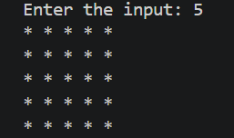
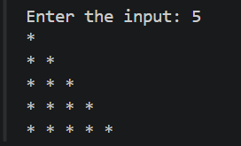
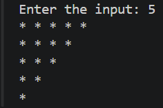
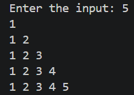
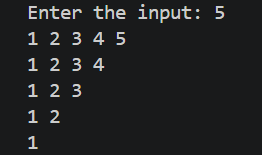

### Day 2 – Patterns 6 to 10

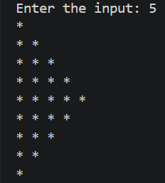
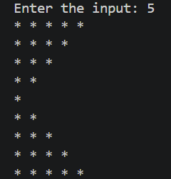
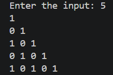
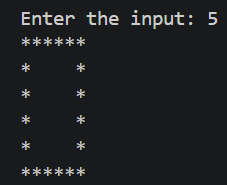
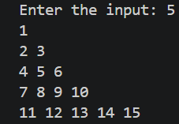

### Day 3 – Patterns 11 to 15

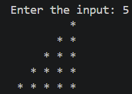
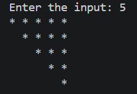
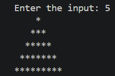
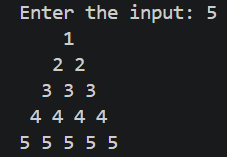
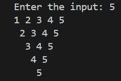

### Day 4 – Patterns 16 to 20

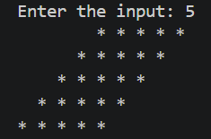
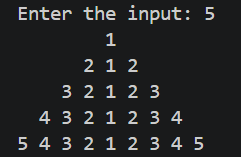
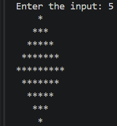
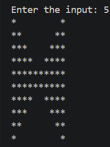
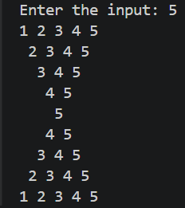

### Day 5 – Patterns 21 to 25

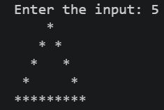
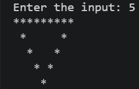
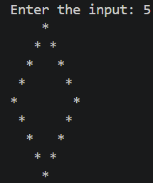
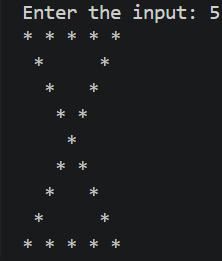
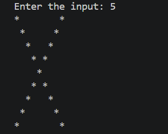
